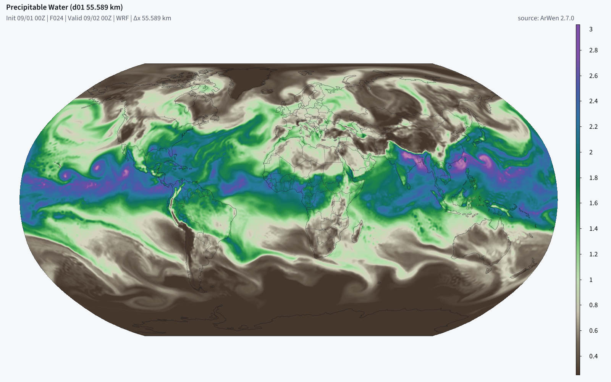
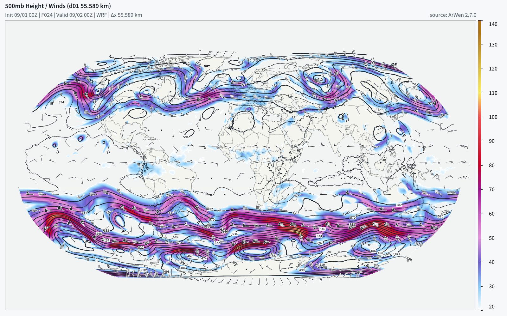
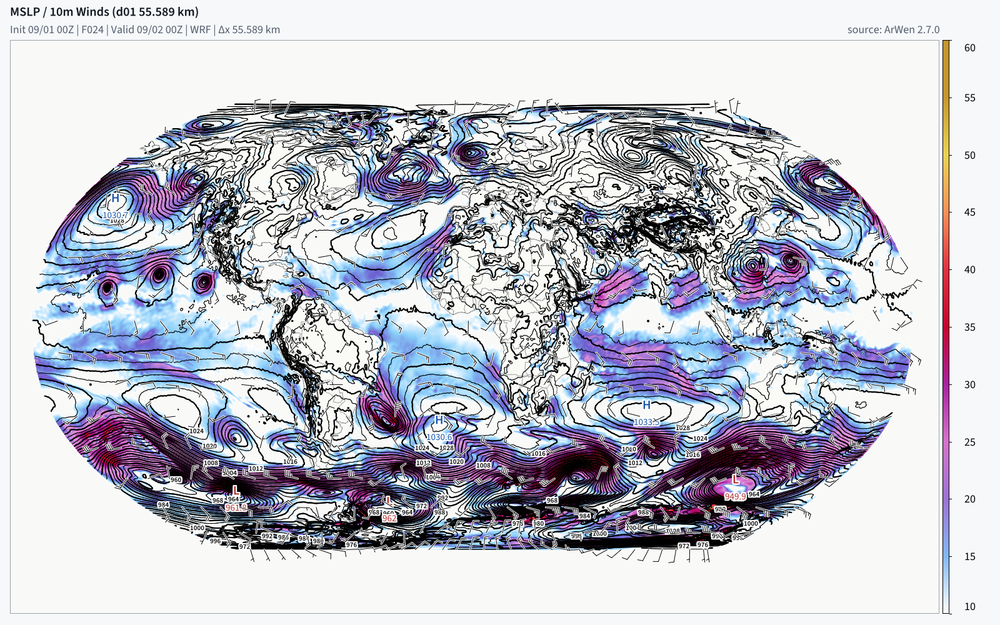
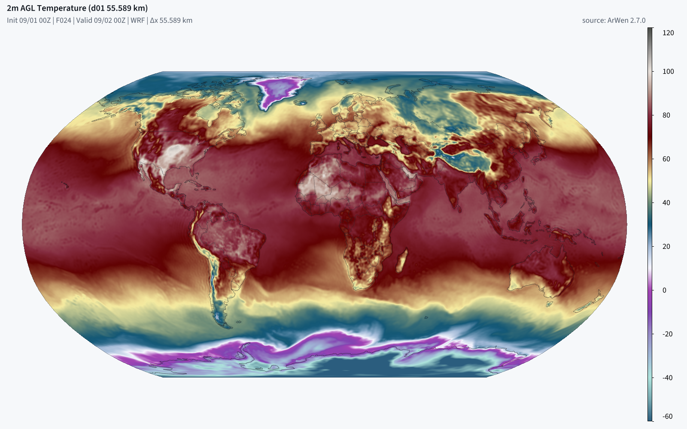
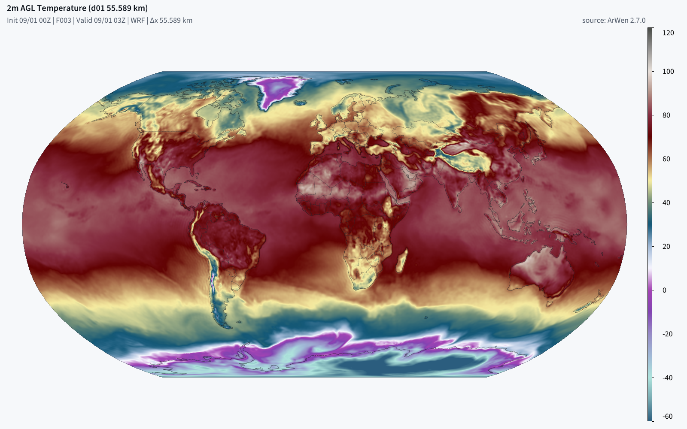

# Arwen Global

A hydrostatic global spectral weather model that runs a whole forecast day on
one consumer graphics card, with its own ensemble data assimilation.

Arwen Global integrates the moist primitive equations on a Gaussian grid in
spherical-harmonic space, on a two-time-level semi-Lagrangian semi-implicit
core at a 300 s step, with a full GPU physics suite (RRTMGP radiation, Morrison
microphysics, Grell-Freitas or New Tiedtke convection, YSU boundary layer, Noah
land, MM5 surface layer) on a 52 to 25 km grid at 40 hybrid levels. It
cold-starts from a single public GDAS analysis, writes render-ready `wrfout`
tapes that the same Rust renderer draws as every other ArWen product, and can
run its own analysis cycle: a 32-member LETKF under the forecast control, fed
by surface observations, radiosondes, buoys, satellite motion vectors and radio
occultations through Rust decoders, with infrared and microwave radiance
operators beside them. At 52 km a 24 hour global forecast takes about four
minutes on a 16 GB card, and at 25 km about sixteen minutes on a 32 GB one.
Every number on this page was measured; each one carries the card and the date.

**This is an experimental research model.** Its configuration surface can move
between releases and its output is not a supported product. The claims it does
not make are listed in [docs/ARWEN_GLOBAL_FULL.md](docs/ARWEN_GLOBAL_FULL.md).

---

## Install

```bash
pip install "gpuwm-global[gpu-cu13]"     # a CUDA 13 runtime
pip install "gpuwm-global[gpu-cu12]"     # a CUDA 12 runtime
```

One extra per CUDA major, because no pip environment marker can tell them
apart. `gpu-cu13` pulls `cupy-cuda13x[ctk]`, `gpu-cu12` pulls
`cupy-cuda12x[ctk]`, and the bare `gpu` alias is `gpu-cu13`, the stack the
card figures on this page came off. Either line also resolves the engine
`gpuwm>=2.9.13,<2.10`, its data companion `gpuwm-data` beside it, numpy, scipy
and netCDF4. Against the published `gpuwm 2.9.13`,
`python tools/measure_boundary.py` reads 240 symbols across 71 modules with
no gap (Linux, 2026-11-11). Without either extra the package installs and
every CPU door runs; the forecast needs the card.

The rows dated 2026-11 on this page were taken on the published engines
(`gpuwm 2.9.12` and `2.9.13`). The older forecast and assimilation figures
were taken on 2026-09-06 and 2026-09-07 in the engine checkout this model was
developed and graded in, whose own version string reads 2.6.4. That physics is what `arwen_global.core` carries, which is why
an install on the 2.8 engine integrates the same bytes those runs did, apart
from the engine fixes this package has taken since (listed under PULL in
[docs/CARRIED-PHYSICS-DIVERGENCE.md](docs/CARRIED-PHYSICS-DIVERGENCE.md)).

The Rust binaries the model calls at run time arrive as release assets,
verified against the size and SHA-256 pins inside the wheel before they are
used, never from a local `cargo` build:

```bash
gpuwm fetch-bridges        # the engine's own bundle
gpuwm-global fetch-doors   # the doors the engine's bundle does not carry: observation binaries and this package's own libraries
gpuwm-global doctor        # what is installed, staged and missing
```

Of the eight observation doors, `rw_asos`, `rw_igra2`, `rw_ndbc`,
`rw_amv`, `rw_gnssro`, `rw_wis2` and `rw_goes` arrive in the engine's own
bundle on 2.9.x, so `fetch-doors` stages the other one.  It also stages the
two libraries this package builds from its own `rust/` workspace: `rw_global_coldstart` (the cold start's analysis regrid
and ln p remap) and `global_render_kernels` (the render tapes' regrid and
column and the regional translation).  Neither has a NumPy fallback, so an
install whose bundle predates them builds them from the source
(`cargo build --release` in `rust/`) and names each library in its
variable, as `doctor` says.

`doctor` exits 1 when a command this page or
[docs/CLI-REFERENCE.md](docs/CLI-REFERENCE.md) documents cannot run, and every
line that says no names the command it stops and the remedy. Two engine
symbols are absent from every published engine through 2.9.13:
`preflight.measured_free_vram_bytes` and `surface_bias.interpolate_to_tape`.
Neither stops a documented command (the first stops the standalone
card-pricing check that no subcommand is wired to, the second the
surface-energy scorecard's regrid onto the tape), so `doctor` prints both as
optional notes and a correct install exits 0: the three lines above, then
`doctor`, exited 0 against `gpuwm 2.9.13` on Linux (MEASURED 2026-11-07). CI runs the same three lines on every push and every
publish and fails on any gap. Calling either symbol still refuses by name.
The published 0.1.2 graded both as gaps and exited 1 on every correct
install; that is fixed from 0.1.3.

`gpuwm-global` needs `gpuwm>=2.9.13,<2.10`. The floor is the engine this
release's test suite and forecast proofs ran on. The ceiling is not
decoration: the engine's own trees are not supersets of each other across
minors, and this package imports 240 symbols across that boundary.
`python tools/measure_boundary.py` regenerates the measurement rather than
trusting a table, and names the symbols it could not check on a host without
a CUDA runtime instead of counting them clean. The physics used in the
observation-scored runs is INSIDE this package (`arwen_global.core`: the
radiation, cumulus, surface-layer, boundary-layer, land-surface and
microphysics schemes, their kernels, the CUDA loader, the float64 mirror used
by kernel scorecards to compare GPU arithmetic (code verification, not an
observation score), and the Noah tables). The engine files the carried code
still reaches are pinned by path, size and SHA-256 in
`arwen_global/data/engine-seam.json`, and `gpuwm-global doctor` re-hashes them
and prints an `engine seam` section. The pins are taken at `gpuwm 2.9.13`,
where all 48 files are proven. Between 2.8.5 and 2.9.12, 40 of the then 47
files moved and each was re-pinned after the suite passed on 2.9.12; 2.9.13
moved one more (`gpuwm/core/preflight.py`, one comment line), and the engine's
CAM ozone reader (`gpuwm/ingest/wrf_ozone.py`) joined the seam with this
release's default ozone.

The two nodes of `tests/test_arwen_global_engine_seam.py` that compare
hashes run against the pinned version and skip, naming both versions, on any
other; a file whose bytes moved is reported by name as unproven, and the
version ceiling is the refusal. Where the carried physics differs from the
engine's own copy of the same file, and whether a future engine change to
that code should be taken, refused or offered back, is one row per
difference in
[docs/CARRIED-PHYSICS-DIVERGENCE.md](docs/CARRIED-PHYSICS-DIVERGENCE.md), held
to the installed engine by `tests/test_engine_divergence.py`, which is
baselined on 2.8.5 and skips its two comparisons, naming both versions, on
any other.

---

## A forecast day, in one command

```bash
gpuwm-global go arwen_global_gdas_t255_native_sl_si_24h \
    --outdir out/day --start-date 2026-09-01_00:00:00
```

That builds the static surface fields, integrates the forecast, exports
render-ready tapes and draws the product pictures, naming the stage it is in
while the detail goes to the run's log.

Fifty-seven experiments ship inside the package and resolve by bare name from
any directory (`gpuwm-global configs` lists them); a path that exists always
wins over a shipped name, so an edited copy runs.

### The same day, one stage at a time

**1. Fetch the analysis.** One whole-globe GDAS object, about 500 MB, no
credentials.

```bash
gpuwm fetch --source gdas --cycle 2026-09-01T00 --hours 0 \
  --mode full-file --out cases/baseline-2026090100
```

`--hours 0` takes the f000 analysis alone, which for GDAS is the assimilation
cycle's own estimate of the atmosphere rather than a forecast field.
`--mode full-file` takes the whole globe: the default GDAS transport is an area
crop, and the initializer refuses a longitude ring that does not close.

**2. Build the surface statics**, once per truncation, from the geography
archive.

```bash
gpuwm-global statics arwen_global_gdas_t255_native_sl_si_24h --geog-root ~/WPS_GEOG
```

**3. Run the day.** Nothing about memory is set: the door prices the card,
chooses the latitude band count and decides which state slices to park on the
host, and refuses before it allocates anything if the card cannot hold the run.

```bash
gpuwm-global run arwen_global_gdas_t255_native_sl_si_24h --outdir out/t255-day
```

288 whole steps at 300 s, a checkpoint every three hours, `diagnostics.jsonl`
and a self-hashed receipt beside them. `gpuwm-global check-receipt` validates
the receipt; `--restart` continues from a checkpoint.

**4. Draw it.**

```bash
gpuwm-global render out/t255-day \
  --outdir out/pictures --start-date 2026-09-01_00:00:00 \
  --products 2m_temperature,mslp_10m_winds,500mb_height_winds
```

`render` takes checkpoints, a whole run directory or tapes that are already
exported; it writes the intermediate tapes itself and removes them unless
`--keep-tapes` is given. No experiment is named on that line because `run` and
`go` leave a byte copy of the config beside their checkpoints, so a run
directory says what made it; `--config` states it for inputs that are not in
one. `gpuwm render TAPE --list-products` prints the catalogue and says which
entries a given tape can actually fill. The tapes carry `MAP_PROJ = 6`, so
global frames go out through the ordinary layout,
`<outdir>/<domain>/<product>/<valid-day>/`.
Weather fields are drawn by the Rust renderer `rw_wrfbatch` and by nothing
else. `gpuwm-global export` writes the tapes without drawing them.

**No card?** `arwen_global_moist_smoke` is a T3 four-step numpy run that goes
through the identical run, export and render sequence in seconds and produces a
real global frame. It rehearses the plumbing, not the forecast.

---

## A fresh global analysis

```bash
gpuwm-global da fresh arwen_global_gdas_t255_native_sl_si_24h \
  --outdir out/fresh --stream iem-asos --filter letkf --members 32
```

`da fresh` fetches the newest GDAS analysis, derives its run configuration from
the base experiment named on the line, builds the ensemble if the output
directory has none, cycles hourly to the newest observation hour, and hands
back the analysis checkpoint. At least one observation source is required and
named: `--stream` fetches a stream for every window, `--obs` reads a table
already on disk, and both repeat. Without `--filter letkf` the analysis is the
deterministic successive correction with a single member, which is the shipped
default.

The receipt `out/fresh/da-receipt.json` names the analysis checkpoint it handed
back and carries `forecast_command`, the exact line that forecasts from it:

```bash
gpuwm-global da forecast out/fresh/fresh-config.toml \
  --analysis out/fresh/arwen_global_analysis_step00000036.npz \
  --outdir out/fresh/forecast
```

The forecast runs to the derived configuration's duration, which is the cycle
span plus `--forecast-hours` (24 by default); `--until-s` stops it earlier. The
legs are separately reachable: `da init` builds the ensemble, `da cycle` runs
the hourly windows over named streams, `da analyze` analyses one instant. Every
analysis writes a report with the observation counts, the quality-control
rejections by name, the o-minus-b and o-minus-a fits by stream and variable,
and the Desroziers diagnostics.

`gpuwm-global obs streams` prints the ten observation streams with the Rust
door each one decodes through, whether that decoder is built, and its measured
latency behind real time; `gpuwm-global obs fetch` writes a stream's table to
disk for `--obs`.

**Two measured assimilation arms.** The first used six hourly LETKF cycles
from the GDAS 2026-08-31 18Z analysis, 32 T127 members under a T255 control,
and METAR, IGRA2, NDBC and GOES derived motion winds. It offered 879,488 rows
over six windows; METAR surface-pressure o-minus-b grew from 115 to 158 Pa
while o-minus-a held at 76 to 82 Pa (measured 2026-09-06).

A later arm started from GDAS 2026-09-01 18Z and cycled to 2026-09-02 00Z.
Against the stations, its handed-back analysis reads 2 m temperature
+0.45 / 2.10 K against the same-instant GDAS analysis's -0.35 / 2.35,
2 m dewpoint +0.16 / 2.60 against -2.53 / 4.10, and mean sea-level pressure
-1.05 / 2.44 hPa against -1.68 / 2.79 (bias / RMSE). Its 10 m wind RMSE is
worse: 2.05 against 1.91 m/s, on the same 1,591 stations. These reports
come from the METAR/ASOS record the cycle assimilated, so the analysis scores
measure fit to assimilated data, not independent forecast accuracy. It is
also worse than same-instant GDAS at the soundings (measured 2026-09-06).

The later arm's subsequent 24 h forecasts improve 2 m temperature and dewpoint
relative to the GDAS cold start but lose on sea-level pressure, 10 m wind,
500 hPa height at 12 h, and every sounding temperature and wind row. The
[DA evidence](docs/ARWEN_GLOBAL_DA.md#the-first-real-arm-and-what-ships)
separates the two analysis times and the forecast scores. The system remains
**selectable, not default**; these case results do not establish general skill.

The analysis runs on the card. The analysis proper (the step less the members'
forecast hour and the control re-integration) costs 26.4 s on an RTX 5090,
against 185.8 s on the host path, and the whole hourly cycle costs 390.5 s, so
a cycle keeps up with the hour it covers by a factor of eight
(MEASURED 2026-09-07).

**The quickstart itself, run from the installed wheel.** Three hourly cycles
from the GDAS 2026-09-01 00Z analysis over the public surface stream on the
shipped deterministic filter, on an RTX 5070 Ti shared with another job:
status `pass`, three of three cycles engineering-complete, 596.5 s for the
whole command, 76.1 s a cycle on average and 89.6 s at worst, which is 0.025
of the hour each cycle covers. At the third analysis 20,713 rows were
assimilated and 2,302 withheld from it for the gate of record. Station
pressure read 403.2 Pa o-minus-b against 113.2 o-minus-a on 4,519 rows,
temperature 1.946 against 1.816 K on 4,717, and the wind components 2.157
against 2.047 and 2.156 against 2.085 m/s. Dewpoint read 3.383 against 3.411,
worse after the analysis than before it, and the door printed that as a
reading rather than hiding it: `--moisture-update` is off by default, so
dewpoint rows are scored and not analysed (MEASURED 2026-09-07).

---

## What it runs on

A 24 hour forecast, 288 steps at 300 s on the shipped semi-Lagrangian core, the
full native physics suite, 40 hybrid levels, float32. Wall clock is end to end
from each run's own receipt. "Shared" means another process held the card, so
the row is a capability row rather than a timing.

Every row was measured on the date in its last column. Rows dated 2026-09
were measured in the engine checkout this model was developed and graded in,
whose version string reads 2.6.4; rows dated 2026-11 on the published
`gpuwm 2.9.12` and `2.9.13`, with this release's physics (CAM ozone, the top
drag, the dated surface series).

| Truncation | Gaussian grid | Equator spacing | Card | A forecast day | Device peak | Measured |
|---|---|---|---|---|---|---|
| T63 | 96 x 192 | 208.5 km | RTX 5090, 32 GB, alone | **1.8 min** (108.0 s; 0.363 s a step), `arwen_global_gdas_t63_native_sl_si_24h` (experimental, [not a forecast](docs/arwen-global-coarse-grids.md)) with no flag | 2.50 GiB live, 3,508 MiB on the card | 2026-11-12 |
| T127 | 192 x 384 | 104.2 km | RTX 5090, 32 GB, alone | **2.9 min** (171.8 s; 0.514 s a step), `arwen_global_gdas_t127_native_sl_si_24h` (experimental, not a forecast) with no flag | 3.32 GiB live, 5,180 MiB on the card | 2026-11-12 |
| T255 | 384 x 768 | 52.1 km | RTX 5070 Ti, 16 GB, alone | **4.28 min** (256.7 s) | 8.70 GiB | 2026-09-06 |
| T255 | 384 x 768 | 52.1 km | RTX 5070 Ti, bare from the door | 245.8 and 246.0 s | 8.70 GiB | 2026-09-07 |
| T255 | 384 x 768 | 52.1 km | RTX 5090, shared | 186.8 and 228.9 s | 8.70 GiB | 2026-09-07 |
| T255 | 384 x 768 | 52.1 km | RTX 5070 Ti, 16 GB, alone | **4.04 min** (242.4 s; 0.747 s a step), the shipped day with no flag, from the GDAS 2026-09-01 00Z analysis; 0.1.6 on the same card the same day 4.83 min (0.914 s a step), byte-identical | 6.70 GiB live, 9,028 MiB on the card (0.1.6: 8.63 GiB, 11,582 MiB) | 2026-11-12 |
| T383 | 576 x 1152 | 34.7 km | RTX 5090, shared | **5.63 min** (337.9 s) | 15.86 GiB | 2026-09-07 |
| T383 | 576 x 1152 | 34.7 km | RTX 5070 Ti, 16 GB, alone | **11.8 min** (2.46 s a step; 12.4 min with the cold start), one band, nothing parked on the host | 12.10 GiB live, 15,624 MiB on the card | 2026-11-07 |
| T383 | 576 x 1152 | 34.7 km | RTX 5070 Ti, 16 GB, alone, 10 days | 108.9 min for 240 h (2.24 s a step) | 12.10 GiB live, 15,212 MiB on the card | 2026-11-06 |
| T383 | 576 x 1152 | 34.7 km | RTX 5070 Ti, 16 GB, alone | **10.7 and 10.8 min** (2.220 and 2.250 s a step over two days), one band, nothing parked, the pool held from 11.50 GiB and raised to 13.86 and 13.15 | 11.95 GiB live, 14,608 and 13,880 MiB on the card | 2026-11-12 |
| T383 | 576 x 1152 | 34.7 km | RTX 5070 Ti, 16 GB, alone | **13.7 min** (2.852 s a step), two bands, every slice parked, the pool held from 9.25 GiB and raised to 10.43 | 8.99 GiB live, 11,090 MiB on the card | 2026-11-12 |
| T383 | 576 x 1152 | 34.7 km | RTX 5070 Ti, 16 GB, 2,270 MiB held by another process | **13.7 min** (2.863 s a step; 14.8 min with the cold start), chosen by the door at 13.02 GiB free with no flag: two bands, every slice parked | 9.52 GiB live, 12,486 MiB on the card | 2026-11-12 |
| T383 | 576 x 1152 | 34.7 km | RTX 5070 Ti, 16 GB, 4,318 MiB held by another process | **14.1 min** (2.941 s a step; 15.1 min with the cold start), chosen by the door at 11.02 GiB free with no flag: four bands, every slice parked (on the door's figures of 2026-11-11; it now takes two bands there) | 7.29 GiB live, 11,342 MiB on the card (the pool grows into the room it has) | 2026-11-12 |
| T383 | 576 x 1152 | 34.7 km | RTX 5070 Ti, 16 GB, alone | **14.1 min** (2.933 s a step; 15.1 min with the cold start), `--latitude-bands 4 --host-spill on`, the pool held under 10.0 GiB | 7.29 GiB live, 10,582 MiB on the card | 2026-11-11 |
| T383 | 576 x 1152 | 34.7 km | RTX 5070 Ti, 16 GB, alone | **14.9 min** (3.098 s a step), `--latitude-bands 4 --host-spill on --device-allocator async` | 7.23 GiB live, 9,676 MiB on the card | 2026-11-12 |
| T383 | 576 x 1152 | 34.7 km | RTX 5070 Ti, 16 GB, alone | **9.6 min** (578.5 s; 1.805 s a step), the shipped day with no flag, from the GDAS 2026-09-01 00Z analysis: one band, nothing parked, chosen by the door at 15.24 GiB free, the pool held from 11.50 GiB and raised to 13.66; 0.1.6 on the same card the same day 15.3 min (2.981 s a step) at two bands with every slice parked, byte-identical | 11.94 GiB live, 14,392 MiB on the card (0.1.6: 12.00 GiB, 15,142 MiB) | 2026-11-12 |
| T383 | 576 x 1152 | 34.7 km | RTX 5070 Ti, 16 GB, alone | **10.2 min** (610.7 s; 1.907 s a step), `arwen_global_gdas_t383_native_24h`, the config of record on the default core, with no flag, from the GDAS 2026-08-30 18Z analysis: one band, nothing parked (the day on the chunk change's own tree, before the stored checkpoints joined it); over 3 h 1.832 s a step where 0.1.7, at the 12,500-column radiation chunk it carried, took 2.535 at two bands with every slice parked, byte-identical | 11.84 GiB live, 14,316 MiB on the card | 2026-11-12 |
| T533 | 801 x 1602 | 25 km | RTX 5090, 32 GB, alone | **15.9 min** (953 s; 2.98 s a step) | 23.23 GiB live, 28.11 held | 2026-09-07 |
| T533 | 801 x 1602 | 25 km | RTX 5070 Ti, 16 GB, alone | **34.0 min** (6.67 s a step) with `--streaming on --device-allocator async`: four bands, every slice parked | 12.81 GiB live, 15,756 MiB on the card | 2026-11-06 on `gpuwm 2.8.9`; admitted by the door and its first hour rerun on `2.9.13`, 2026-11-07 |
| T799 | 1200 x 2400 | 17 km | either card | **refused at the door**, before a byte is allocated, with the figure that refuses it | priced 30.31 GiB live | 2026-09-07 |

At the same truncation on the same tree, the selectable Eulerian core
`imex_ssp3` takes 1,099.3 s for the T255 day at a 60 s step and 1,050.2 s at
its shipped 90 s step on the RTX 5070 Ti (MEASURED 2026-09-06 and 2026-09-07).
A 300 s semi-Lagrangian step costs about one Eulerian step, so the day is 288
steps instead of 960.

**The card is priced, not guessed.** `run` estimates the device peak, weighs it
against free VRAM, chooses the latitude band count and the host tier, and
refuses a plan that will not fit, naming which allocation dies first. Across
seventeen legs with a card reading, the gate was on the refusing side every
time, the tightest by 0.047 GiB (MEASURED 2026-09-06). Where a completed run of
a lighter plan bounds a heavier one, the door prices at that measurement
instead of at its model, and the receipt names the run that bounded it.

**A 16 GB card with a desktop on it.** A run holds its CuPy pool to a limit,
so the pool no longer grows into whatever the card has free: T383 at one band
took 15,624 MiB of a 16 GB card over a day before the limit and 13,880 and
14,608 MiB over two days held to it (the pool held from 11.50 GiB and raised
to 13.15 and 13.86 GiB: where it ends is set by how its blocks were cut, not
by the forecast), byte-identical, 2.250 and 2.220 s a step against 2.235 for
the tree before. The door prices it at the heavier day and asks 14.27 GiB free
for it at the 5,000-column radiation chunk, where it asked 14.93. With less free it
takes two latitude bands with every slice parked in pinned host memory from
10.83 GiB free, or four from 10.33, priced at what those plans' own runs took,
and its line says what the plan costs against one band and what the pool is
held to. The banded rows above are those plans: 28 and 32 percent slower than
one band on the same card, 2.27 GiB in pinned host memory, and about 2 GiB
more host RAM at the peak (7.4 GiB against 5.3). Below 10.2 GiB free the door
refuses and names `--device-allocator async`, whose four-band day took 9,772
and 9,676 MiB of the card over two 24 h days at 3.087 and 3.098 s a step,
byte-identical to the one-band day; the door prices it at the heavier
(MEASURED 2026-11-12). A `CUPY_GPU_MEMORY_LIMIT` set in the environment
stands instead of the run's own limit. The shipped T383 semi-Lagrangian day
carries the 5,000-column radiation chunk these rows were measured at; at the
12,500 it carried before, the step peaked 0.99 GiB higher live and took 2.42
to 2.45 s against 2.28 to 2.29 over 3 h, byte-identical (MEASURED
2026-11-12), and a config that still says 12,500 is pointed at
`radiation_column_chunk = 5000` by the door's refusal. From 0.1.8 so does
`arwen_global_gdas_t383_native_24h`, the config of record on the default
core, and the door runs it at one band on an empty 16 GB card (the row
above).

**A 12 GB card.** No 12 GB card was measured; the 16 GB card stood in for
one, with another process holding all but what a 12 GB card leaves free.
From the door with no flag, 24 h T383 days from the GDAS 2026-11-11 00Z
analysis: at 11.59 and 11.05 GiB free it chose two bands with every slice
parked, 10,880 and 10,972 MiB of the card at 2.858 and 2.871 s a step (13.7
and 13.8 min a forecast day); at 10.52 GiB free it chose four, 10,322 MiB at
2.961 s (14.2 min). Every array of all nine checkpoints of each day is
byte-identical to the one-band day (MEASURED 2026-11-12, RTX 5070 Ti). The
minutes are that card's: a 12 GB card's own step was not measured.

**Banding does not move a bit.** The physics suite runs a latitude band at a
time, and the ten-step T255 gate of record is byte-identical between one band
and eight: 309 of 309 checkpoint arrays, on both cards (MEASURED 2026-09-07).
The host tier is the same: 442 of 442 checkpoint arrays byte-identical with the
tier off against on (MEASURED 2026-09-07). Over a T383 day it holds as well:
two and four bands with every slice parked reproduce the one-band day's 133
checkpoint arrays byte for byte at step 288 (MEASURED 2026-11-11 and
2026-11-12, RTX 5070 Ti). The banded transforms are exact too:
93 of 93 FFT cases bit-exact at 0 ULP across T255, T383 and T533 crossed with
band counts 2 to 32, and 892 of 892 waist comparisons bit-exact on each card
(MEASURED 2026-09-06).

---

## The doors

One console script, 51 commands. `gpuwm-global <command> --help` prints every
option; [docs/CLI-REFERENCE.md](docs/CLI-REFERENCE.md) is the same surface on
one page, generated from the parser.

| Command | What it does |
|---|---|
| `go` | statics, forecast, tapes and pictures in one command |
| `run` | run a configured experiment: the forecast, its gates and its receipt |
| `statics` | build and cache the surface static fields for a truncation |
| `surface-series` | build a dated SST, sea-ice and greenness series on a config's grid, from GDAS analyses or one GFS cycle's own forecast, for `run --surface-series` |
| `export` | render-ready global lat-lon `wrfout` tapes from checkpoints (`export-wrfout` is an accepted alias of the same door) |
| `render` | draw the products from a finished run through the Rust renderer |
| `configs` | list the experiments that ship inside the package |
| `doctor`, `fetch-doors` | what is installed, staged and missing; and stage what is missing |
| `fetch-analysis` | fetch the one whole-globe GDAS object a cold start needs, or with `--source era5` one ERA5 hour from 1940 on ([ERA5 start](docs/ARWEN_GLOBAL_ERA5.md)), and print the run it feeds |
| `score` | score a finished run against ASOS stations and radiosondes through `rw_asos` and `rw_igra2`, with the GFS and IFS analyses as secondary references, one row per lead, at any truncation |
| `assimilate` | assimilate point observations into one checkpoint |
| `cycle` | forecast and assimilate in one process, an analysis every interval |
| `da init`, `da cycle`, `da analyze`, `da fresh`, `da forecast`, `da static-covariance`, `da localisation` | the ensemble door: build, cycle, analyse one instant, do all of it from nothing, forecast from the analysis, estimate the hybrid's static covariance from lagged forecast pairs, derive the localisation radii from the members |
| `obs fetch`, `obs subscribe`, `obs hours`, `obs summary`, `obs streams`, `obs anchors` | the observation tables: fetch them, subscribe to the live feed, see which hours are covered, what each stream carries and where it is anchored |
| `microwave` | the ATMS leg: fetch, decode, thin and score microwave radiances |
| `abi-score`, `abi-reference`, `abi-fast-model` | the GOES ABI infrared operator, its CRTM reference leg and its trained fast model |
| `export-mapped-parent` | regional parent frames from checkpoints: model-level NetCDF on a regular lat-lon grid with the mapping and composition documents `gpuwm prep --source mapped` reads, so the forecast is the initial and lateral boundary data of a regional run |
| `export-parent`, `make-regional-target`, `translate-regional-frame`, `make-parent-series` (and their `inspect-` twins) | the one-way bridge that hands a limited-area model its lateral boundaries |
| `pins`, `physics-manifest`, `transform-check` | the arithmetic identity, the admitted physics adapters, the transform controls |
| `inspect`, `check-receipt`, `check-migration`, `check-native-evidence`, `check-native-candidate` | validate a checkpoint, a receipt, a migration, a device-qualification record |
| `migrate-level4-checkpoint` | carry an older checkpoint onto the current state contract |
| `native-qualify` | run the target-device qualification battery for the native physics suite |
| `run-plan` | the machine seam: discover sources, products and physics, probe the machine, resolve and estimate a plan, then execute it and leave a durable event stream |
| `sources` | every source this model initializes from or scores against, and which authority table answered its mapping: the engine's or this package's carried copy |

`run`, `go`, `render` and `run-plan` write `status.json` into their output directory,
rewritten atomically at each stage and at each step, and an append-only log
beside it: these are the four long-running doors, and a workspace driving one
of them reads its stage, its progress and its ending from that file rather
than by scraping a growing console. The shorter commands print their answer
and are read by watching stdout. Exit codes are `0` success, `1` a refusal
that names its reason, `2` an argument error, `3` a Rust door missing or
failing its pin, `4` the device declining admission, and, from `go` only,
`5` a forecast that stopped before its end (a refusal inside the model)
after the hours it reached were drawn into `pictures/`. Every finished run leaves
a self-hashed receipt carrying the configuration identity, the arithmetic
pins, the library versions the numbers rode on, the engine version and the
staged binary digests, so a run can be compared to a configuration without
opening a checkpoint.

### Driving it from a program

A desktop application, a terminal workspace or a CI job drives this model
through the same versioned contract the engine publishes, so a client written
for `gpuwm` drives `gpuwm-global` by changing the module it spawns.

```bash
gpuwm-global sources --json                          # gpuwm.run-plan.sources.v1
gpuwm-global run-plan --catalog                      # gpuwm.run-plan.catalog.v1
gpuwm-global run-plan --physics-profiles             # gpuwm.run-plan.physics-profiles.v1
gpuwm-global run-plan --probe --no-readiness         # gpuwm.run-plan.probe.v1
gpuwm-global run-plan plan.json --resolve            # gpuwm.run-plan.resolved.v1
gpuwm-global run-plan plan.json --estimate           # gpuwm.run-plan.estimate.v1
gpuwm-global run-plan plan.json                      # execute; events on stdout
```

A plan is a `gpuwm.run-plan.v1` envelope over an experiment TOML, and
`config.path` takes a shipped experiment's bare name. A run writes
`run-manifest.json`, `run-progress.json` and `events.jsonl` beside the
`status.json` above, all three in the engine's own schemas, so a client
reattaches to a run of this model with the reader it already has.
`python -P -m arwen_global.tui_worker --job-dir DIR -- <args>` is the same
durable handshake as `gpuwm.tui_worker` for a detached job.

[docs/ARWEN_GLOBAL_CLIENT.md](docs/ARWEN_GLOBAL_CLIENT.md) is the whole
contract, including what the engine offers that this package does not and why.

---

## What it looks like

These came out of the installed package on an RTX 5070 Ti: a 24 hour forecast
from the public GDAS 2026-09-01 00Z analysis at T255, valid 2026-09-02 00Z,
exported to `wrfout` tapes and drawn by the Rust renderer. Eight products at
nine forecast hours, 72 pictures; four of them here, the rest with their
captions in [docs/demo/CAPTIONS.md](docs/demo/CAPTIONS.md).

| | |
|---|---|
|  |  |
| **Precipitable water.** The intertropical convergence zone, the monsoon over the Bay of Bengal and the South China Sea, mid-latitude moisture plumes, and the dry subtropical highs and Antarctic. | **500 hPa height and wind.** The austral winter jet runs unbroken around the Southern Ocean at over 70 m/s; the northern jet is weaker and split, with closed lows over Siberia and the North Pacific and 594 dam ridges over both ocean basins. |
|  |  |
| **Mean sea level pressure and 10 m wind.** The Southern Ocean storm belt carries lows at 949.9 and 961.5 hPa; tropical cyclones sit in the west Pacific and the Indian Ocean; the subtropical highs close at 1030 hPa. | **2 m temperature.** Late northern summer over the continents, the Sahara and Arabia at their hottest, the Antarctic plateau at its coldest, and the Andes and Himalaya drawn by their own orography. |

And the analysis cycle draws the same way. This is the state the three-cycle
quickstart above handed back, 2 m temperature valid 2026-09-01 03Z, exported
and drawn by `gpuwm-global` in one command:



The mean sea level pressure picture that same run drew at its own step 0 is
byte-identical to the forecast demo's, `md5 b772960e…`, from a different run
on a different day through a different export and a different render call
(MEASURED 2026-09-07).

---

## Where things come from

- **The engine.** `gpuwm` supplies the GRIB2 source decoder, the observation
  front door, the static-field builder, the LETKF filter core, the `wrfout`
  writer, the physics tables and the renderer. This package supplies the
  spectral core, the global dynamics, the global physics registry, the global
  data assimilation and the doors.
- **Every data path is Rust.** GRIB decode, NetCDF read and write, observation
  decoding, regridding and rendering run in Rust binaries the engine stages;
  Python is the command line and the CUDA driver code. The binaries arrive as
  release assets and are verified by size, SHA-256 and a contract marker before
  they are used.
- **The observation doors** the assimilation calls are `rw_asos` (surface
  networks), `rw_igra2` (radiosondes), `rw_ndbc` (buoys), `rw_amv` (satellite
  motion vectors), `rw_gnssro` (radio occultation), `rw_wis2` (the WMO
  information system), `rw_goes` (ABI) and `rw_atms` (microwave).
- **The render kernels** (`global_render_kernels`, built from this
  repository's `rust/global-render-kernels`) regrid the Gaussian grid onto
  every render tape, integrate the tape's hydrostatic column and translate
  parent exports onto regional targets. They ship in the same companion
  bundle as the observation doors.
- **Statics** come from the public geography archive through the engine, cached
  once per truncation.

---

## Documentation

| Page | What it is |
|---|---|
| [ARWEN_GLOBAL_QUICKSTART.md](docs/ARWEN_GLOBAL_QUICKSTART.md) | the route above, with the reasoning behind each flag |
| [ARWEN_GLOBAL.md](docs/ARWEN_GLOBAL.md) | what ships, the resolution rungs, and where the envelope ends |
| [ARWEN_GLOBAL_FULL.md](docs/ARWEN_GLOBAL_FULL.md) | the model: dynamics, hybrid coordinate, physics, receipts, and the non-claims |
| [ARWEN_GLOBAL_DA.md](docs/ARWEN_GLOBAL_DA.md) | the assimilation door, its gates and its grade |
| [ARWEN_GLOBAL_LEVEL5.md](docs/ARWEN_GLOBAL_LEVEL5.md) | the native CUDA physics suite and its device-admission battery |
| [ARWEN_GLOBAL_REGIONAL_PARENT.md](docs/ARWEN_GLOBAL_REGIONAL_PARENT.md) | the global forecast as initial and lateral boundary data of a regional run: the command, the file contract, what is and is not carried |
| [ARWEN_GLOBAL_FORCING.md](docs/ARWEN_GLOBAL_FORCING.md) | experimental: the forcing operator, a run pulled toward a stored record of large scales, and the pull read as model error |
| [LEVEL3_GLOBAL_SPECTRAL_DYCORE.md](docs/LEVEL3_GLOBAL_SPECTRAL_DYCORE.md) | the spectral dynamical core |
| [arwen-global-effective-resolution.md](docs/arwen-global-effective-resolution.md) | what the model resolves, as against what its grid spacing says |
| [arwen-global-coarse-grids.md](docs/arwen-global-coarse-grids.md) | the T63 and T127 days (experimental): what they cost on a card and what they are for |
| [arwen-global-scm-cases.md](docs/arwen-global-scm-cases.md) | the physics suite on seven published single-column cases, scored against their LES ranges (experimental) |
| [arwen-global-twin-scan.md](docs/arwen-global-twin-scan.md) | exact-twin starts and the energy-norm reading of their differences (experimental) |
| [arwen-global-ensemble-da.md](docs/arwen-global-ensemble-da.md) | the ensemble filter, its localisation and its inflation |
| [arwen-global-members.md](docs/arwen-global-members.md) | experimental: forecast members from one analysis, their replay recipes and exact twins |
| [arwen-global-transplant.md](docs/arwen-global-transplant.md) | experimental: one physics scheme's output carried between twins, and how much of their difference it carried |
| [arwen-global-composition-replay.md](docs/arwen-global-composition-replay.md) | experimental: extra transported fields (tags, plumes, ozone) carried over a finished run's checkpoints |
| [arwen-global-radiation-between.md](docs/arwen-global-radiation-between.md) | experimental: the shortwave between two radiation calls following the sun |
| [arwen-global-observations.md](docs/arwen-global-observations.md) | the observation streams, their decoders and their error models |
| [arwen-global-abi-operator.md](docs/arwen-global-abi-operator.md) | the GOES ABI clear-sky infrared operator |
| [arwen-global-microwave-operator.md](docs/arwen-global-microwave-operator.md) | the ATMS clear-sky over-ocean operator |
| [arwen-global-airliner-heights.md](docs/arwen-global-airliner-heights.md) | experimental: the ADS-B altitude pair as an upper-air height observation, and one day measured |
| [ARWEN_GLOBAL_CLIENT.md](docs/ARWEN_GLOBAL_CLIENT.md) | driving this model from a program: the versioned documents, the plan envelope, the durable run files, and what is not offered |
| [CLI-REFERENCE.md](docs/CLI-REFERENCE.md) | every command and every option, generated from the parser |

---

## Licence

Apache-2.0. See [LICENSE](LICENSE) and [NOTICE](NOTICE).
